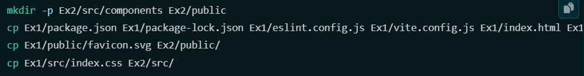
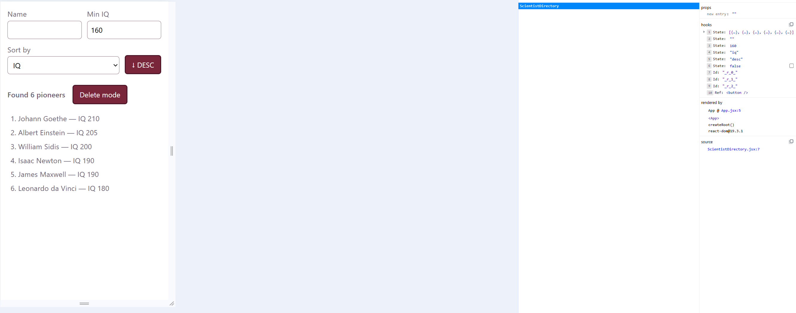
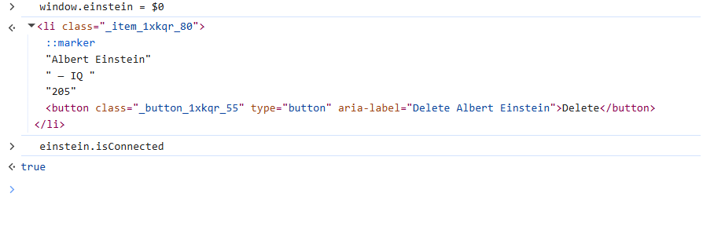
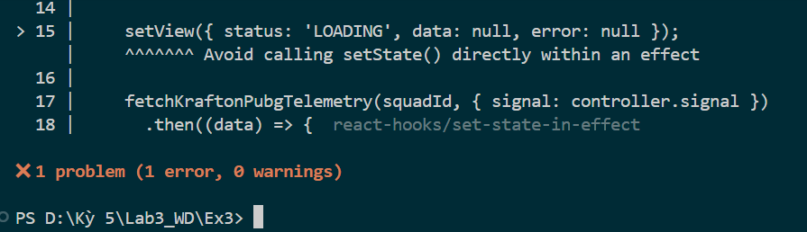
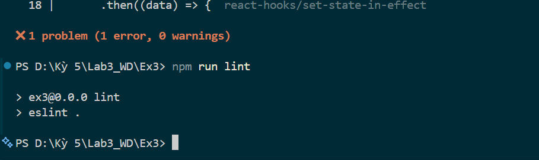

## Lỗi AI #1 – Kế hoạch khởi tạo Ex2 ghi đè project đã có

- **Điểm sai:** Kế hoạch tạo Ex2 bằng cách chép `package.json`, `package-lock.json`, `vite.config.js`, `eslint.config.js`, `index.html` từ Ex1 sang rồi chạy `npm ci`, trong khi `Ex2/` đã được khởi tạo bằng `npm create vite` và `npm install` từ trước. Chạy theo sẽ ghi đè cấu hình đang có.
- **Khắc phục:** Từ chối kế hoạch, chỉ dọn file demo, không đụng các file cấu hình. Kiểm tra `npm ls react` trong Ex2 ra 19.3.1, giống Ex1.
- **Bài học:** Đối chiếu với trạng thái thật của project trước khi chấp nhận bất kỳ lệnh thao tác file nào.
- **Bằng chứng:** 

## Lỗi AI #2 – Kiểm tra key ở sai tab DevTools

- **Điểm sai:** Hướng dẫn xem `key` của các thẻ `<li>` trong tab Components của React DevTools. Tab này chỉ hiển thị component React (`App`, `ScientistDirectory`), không hiển thị phần tử HTML như `<li>`, nên không xem được key ở đó.
- **Khắc phục:** Kiểm tra trực tiếp DOM: chọn `<li>` của Einstein trong tab Elements, lưu bằng `window.einstein = $0`, xóa Goethe, rồi chạy `einstein.isConnected` → `true`. React giữ nguyên thẻ `<li>` của Einstein nhờ `key={p.id}`, chỉ bỏ thẻ của Goethe.
- **Bài học:** Đối chiếu hướng dẫn dùng công cụ với giao diện thật trước khi làm theo.
- **Bằng chứng:**  

## Lỗi AI #3 – setState đồng bộ trong useEffect vi phạm luật lint

- **Điểm sai:** `PubgMatchTelemetry` gọi `setView({ status: 'LOADING', ... })` trực tiếp trong thân `useEffect`. `eslint-plugin-react-hooks` 7.x có luật `react-hooks/set-state-in-effect` chặn việc này, nên `npm run lint` báo lỗi ở dòng 15 dù `npm run build` vẫn thành công.
- **Khắc phục:** Cân nhắc 3 phương án (tắt luật 1 dòng, remount bằng `key`, suy ra LOADING từ squadId). Chọn tắt luật cho đúng 1 dòng kèm comment lý do, vì effect đồng bộ với request mạng và đặt LOADING khi bắt đầu request là chủ đích, giữ đúng contract của đề. Chạy lại lint: không còn lỗi.
- **Bài học:** Build thành công không có nghĩa code đạt chuẩn; luôn chạy lint với đúng phiên bản plugin của project trước khi commit.
- **Bằng chứng:**  

## Lỗi AI #4 – Làm vượt phạm vi task 5.1

- **Điểm sai:** Yêu cầu chỉ làm task 5.1 (FSM), nhưng AI sinh luôn derived state (5.2) và timer `useEffect` (5.3), vi phạm rule "chỉ làm đúng một task" trong `project-rules.md` mục 9.
- **Khắc phục:** Đối chiếu code với `TASK_DECOMPOSITION.md` thì phát hiện phần vượt phạm vi. Tách lại thành bản chỉ có FSM để thử riêng.
- **Bài học:** Đối chiếu code AI sinh ra với đúng task đang làm trước khi chấp nhận.
- **Bằng chứng:** 

## Lỗi AI #5 – Code rút gọn gây trang trắng

- **Điểm sai:** AI đưa code có comment `// ... PHASES, TRANSITIONS... giữ nguyên ...` thay vì code thật. Dán vào thì trang trắng, Console báo `Uncaught ReferenceError: PHASES is not defined`.
- **Khắc phục:** Dán lại đầy đủ phần hằng số và hàm `nextPhase`, khởi động lại dev server, tải lại trang bằng Ctrl+Shift+R.
- **Bài học:** Không dán code có comment rút gọn kiểu "giữ nguyên"; yêu cầu AI đưa đủ code trước khi dán.
- **Bằng chứng:** 
